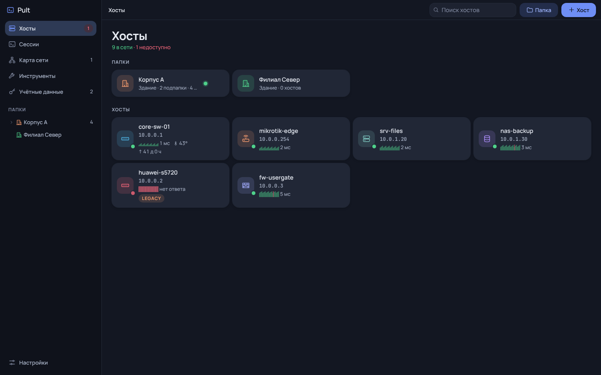

# Pult

Pult — настольный SSH-клиент для администрирования оборудования в локальной сети. Он объединяет список хостов, терминалы, карту сети и сетевые инструменты. Данные хранятся на вашем компьютере; аккаунт и облачная синхронизация не нужны.



## Скачать и установить

Откройте [последний релиз](https://github.com/Trapalenok/Pult/releases/latest) и выберите файл под свою систему:

| Система | Установщик | Запуск без установки |
| --- | --- | --- |
| Windows 10/11 x64 | `Pult-Setup-<версия>.exe` | `Pult-<версия>-portable.exe` |
| Windows 7/8.1, Server 2012/2012 R2 x64 | `Pult-Legacy-Setup-<версия>.exe` | `Pult-Legacy-<версия>-portable.exe` |

Pult Legacy собран на Electron 22. Это устаревший движок без обновлений безопасности; используйте его только на старых системах, где обычный Pult не запускается. Обе редакции используют общую базу на одном компьютере, поэтому не запускайте их одновременно.

Файлы пока не подписаны цифровой подписью. Сверьте SHA-256 с `SHA256SUMS.txt` из релиза. После проверки Windows может показать предупреждение SmartScreen о неизвестном издателе.

При установке новой версии поверх старой база остаётся в `%APPDATA%\ssh-client`. Автоматического обновления в приложении нет: для обновления скачайте новый установщик с GitHub Releases.

## Что умеет

- SSH-терминалы во вкладках, сетке или отдельных окнах; одновременный ввод команд в выбранные сессии и переподключение после обрыва.
- Папки любой вложенности и наследование настроек подключения от папки к хостам.
- Подключение к старому оборудованию с устаревшими SSH-алгоритмами. Включайте совместимый профиль только для нужных устройств.
- Jump-host или SOCKS5-прокси для SSH и некоторых интеграций.
- Карта сети, проверка доступности через ping и SNMP v2c, чтение LLDP-соседей.
- Запуск веб-интерфейса устройства и WinBox из карточки хоста.
- Импорт хостов из CSV, SQLite и JSON; экспорт и перенос конфигурации между компьютерами.

Подробности и снимки экрана — в [инструкции](docs/USAGE.md). История изменений — в [CHANGELOG.md](CHANGELOG.md).

## Данные и ограничения

База каждого пользователя Windows находится в `%APPDATA%\ssh-client\store.json`. Пароли и SNMP community шифруются средствами Windows для текущей учётной записи. Обычное копирование `store.json` на другой ПК не переносит пароли: используйте «Настройки → Перенос конфигурации» и задайте пароль файла. Храните этот файл как секрет.

SNMP v2c передаёт community по сети без шифрования. Проверка ping и SNMP идёт с компьютера пользователя; при использовании jump-host маршрут мониторинга зависит от выбранных настроек. Автоматическое построение связей карты по LLDP пока не реализовано.

Репозиторий сейчас приватный. Встроенной проверки GitHub Releases в приложении нет. Если репозиторий станет публичным, исходники и готовые файлы релизов будут доступны всем: перед открытием проверьте содержимое истории Git и лицензии.

## Разработка

Нужны Node.js 22 и Windows x64. В PowerShell:

```powershell
npm ci
npm run typecheck
npm run test:transfer
npm run test:lldp
npm run dev
```

Сборка обоих вариантов:

```powershell
npm run dist:win
npm run dist:legacy
```

Готовые файлы появятся в `dist\`. Скрипт Legacy собирает отдельную копию проекта в `.build-2012\` и не меняет основную установку зависимостей.

## Как выпустить новую версию самому

1. Обновите код и [CHANGELOG.md](CHANGELOG.md). Проверьте `git status`, чтобы в коммит не попали база, экспорт конфигурации, ключи и пароли.
2. Поднимите версию: `npm version X.Y.Z --no-git-tag-version`. Эта команда обновит `package.json` и `package-lock.json`.
3. Создайте `.github/release-notes/vX.Y.Z.md` с понятным описанием изменений и выбором файлов для установки.
4. Запустите `npm ci`, `npm run typecheck`, `npm run test:transfer`, `npm run test:lldp` и `npm run test:legacy`.
5. Закоммитьте и отправьте изменения: `git add .`, `git commit -m "Release X.Y.Z"`, `git push origin main`.
6. Создайте и отправьте тег на этот коммит: `git tag vX.Y.Z`, `git push origin vX.Y.Z`.
7. Откройте GitHub → Actions → Release и дождитесь успешной сборки. В [Releases](https://github.com/Trapalenok/Pult/releases) проверьте четыре `.exe`, `SHA256SUMS.txt` и текст описания. Не отправляйте тег повторно для исправления ошибки: исправьте код и выпустите следующий номер версии.

Workflow проверяет совпадение тега с версией, запускает проверки, собирает обычный Pult и Pult Legacy на Windows, считает SHA-256 и публикует файлы. Если нужен запуск вручную без тега: GitHub → Actions → Release → Run workflow; номер берётся из `package.json` текущей ветки.

Лицензия: [MIT](LICENSE).
