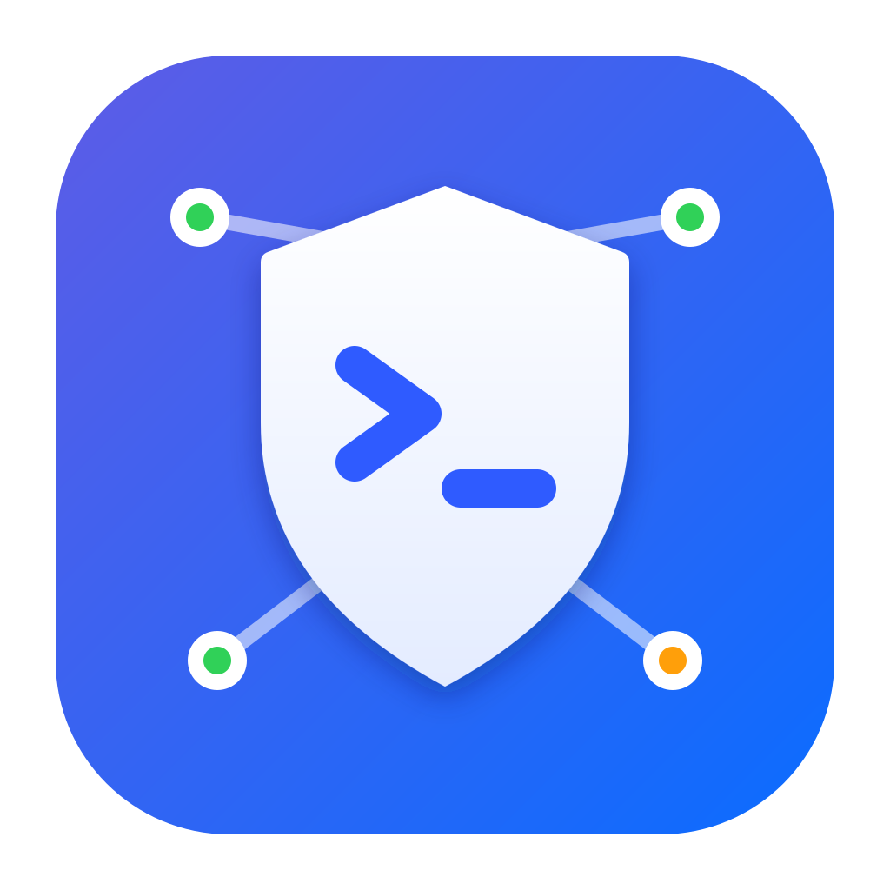
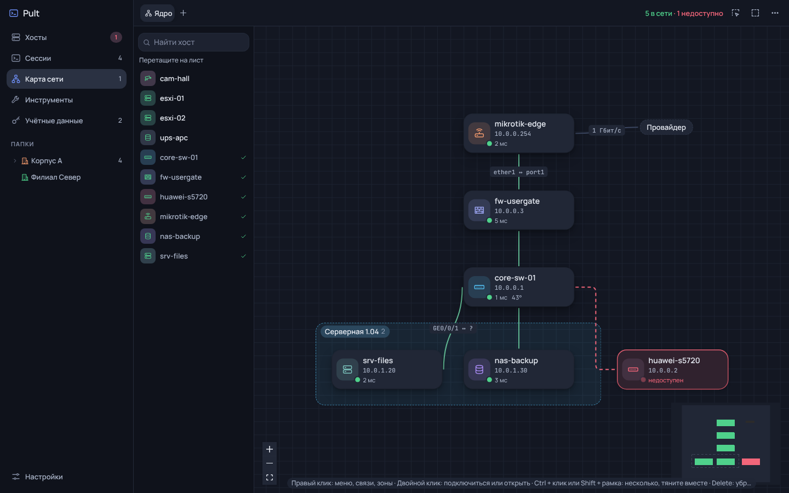
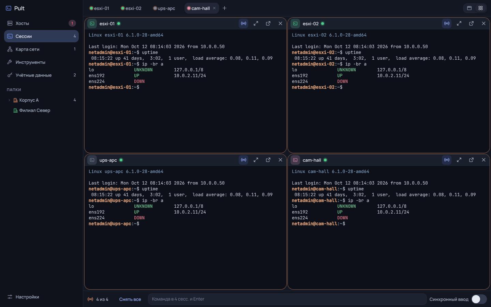
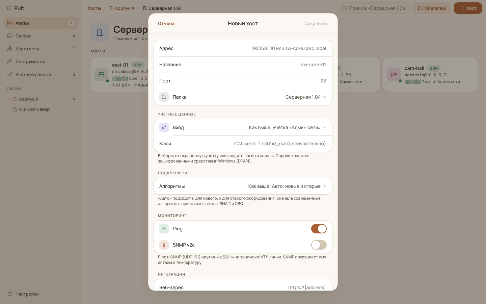

<p align="center">
  
</p>

<h1 align="center">Pult</h1>

<p align="center">
  Пульт управления локальной сетью: SSH, веб-морды, WinBox и сетевые инструменты<br>
  с зашифрованной локальной базой. Windows, Electron.
</p>

<p align="center">
  
  
  
  
</p>

Pult (раньше SSH Client) — десктопный клиент на дизайн-системе Shellwise: папки с наследованием логина и пароля, старое и новое оборудование (вплоть до ssh-dss и group1 у старых Huawei), broadcast, сетка терминалов без ограничений, карта сети и отдельные окна сессий.

- Архитектура и план: [ARCHITECTURE.md](ARCHITECTURE.md)
- Дизайн-система: [DESIGN_SYSTEM.md](DESIGN_SYSTEM.md)
- Скриншоты: [docs/screens-shellwise](docs/screens-shellwise) (6 тем), [docs/screens](docs/screens) (функции)

## Установка

Готовый установщик ([Releases](https://github.com/Trapalenok/Pult/releases)): `Pult-Setup-<версия>.exe` (ставится в профиль пользователя, права администратора не нужны) или `Pult-<версия>-portable.exe` (запускается без установки). Файлы не подписаны, поэтому Windows SmartScreen при первом запуске попросит нажать «Подробнее → Выполнить в любом случае».

Собрать установщик самому: `npm install`, затем `npm run dist:win`, результат в папке `dist`.

Новый релиз собирается на GitHub сам: добавьте заметки в `.github/release-notes/vX.Y.Z.md`, поднимите версию в `package.json` и отправьте тег `git tag vX.Y.Z && git push origin vX.Y.Z`. Через несколько минут оба .exe появятся в Releases.

## Запуск из исходников на Windows

1. Установите Node.js 22 LTS или новее: https://nodejs.org (галочку «Add to PATH» оставить).
2. Откройте PowerShell в этой папке (Shift + правый клик → «Открыть окно PowerShell здесь»).
3. Выполните:

```powershell
npm install
npm run dev
```

Другие команды:

```powershell
npm run typecheck     # проверка типов
npm run test:legacy   # старые алгоритмы против эмулятора старого Huawei
node --experimental-strip-types test/ping-parse.mjs   # разбор вывода ping (русская и английская Windows)
npm run dist:win      # установщик Windows (dist\*.exe)
```

Данные хранятся в `%APPDATA%\ssh-client\store.json` (папка осталась от старого названия, чтобы после переименования ничего не потерялось), у каждой учётной записи Windows своя база. Пароли шифруются средствами Windows (DPAPI) и в интерфейс не возвращаются. При первом запуске показываются примеры папок и хостов; их можно удалить.

## Что работает

- **Папки любой вложенности с уровнями.** Здание, этаж, помещение, стойка, кросс или просто папка: у каждого уровня своя иконка, новая подпапка сразу получает следующий уровень. Дерево папок в боковой панели. Логин, порт, алгоритмы, веб-адрес, WinBox, ping и SNMP задаются на папку и наследуются вниз; хост может переопределить любое поле.
- **Сохранённые учётки.** Раздел «Учётные данные»: логин и пароль один раз, дальше выбор из списка в хосте или папке. Можно сохранить учётку прямо при создании хоста.
- **Ключ хоста.** При первом подключении показывается отпечаток SHA256 и тип ключа, подключение ждёт подтверждения. Для пачки новых коммутаторов есть «Доверять всем новым». Если ключ изменился, отдельное предупреждение. Доверенные ключи хранятся в базе.
- **Мониторинг без VTY.** Ping по ICMP и SNMP v2c (UDP 161): жив ли хост, задержка, температура (Huawei, MikroTik, Cisco, ENTITY-SENSOR), аптайм, имя и модель. Красные точки на папках и в дереве, счётчик недоступных у «Хостов». Интервал в Настройках.
- **Jump-host (мастер-кей).** В Настройках задаётся сервер с OpenSSH, через который идут все хосты, и уже созданные, и новые: вы → мастер-кей → коммутатор. Одно SSH-подключение к мастер-кею на все сессии. Веб-морда и WinBox тоже идут через него по локальному туннелю. Вместо мастер-кея можно выбрать SOCKS5-прокси (адрес, порт, логин и пароль по желанию): через него идут SSH, веб-морда, WinBox и проверка портов. Пинг можно пустить напрямую (ICMP) или через jump-host/прокси (TCP-проверка SSH-порта хоста); SNMP идёт напрямую. Папке или хосту можно выключить «Через jump-host». Пачка хостов (лист карты, папка, выбранные) открывается очередью по 3 сессии: jump-host и прокси обрывают лишние одновременные подключения до handshake, такие подключения повторяются автоматически (до 3 попыток), а очередь сама сбавляет темп до одной сессии, если обрывы продолжаются.
- **Карта сети.** Листы и листы внутри листов (кампус → корпус → этаж) с хлебными крошками; узел вложенного листа показывает, сколько хостов внутри в сети. Связи с именами портов: дуга, прямая или ступенька, изгиб мышкой за точку на выбранной связи. Хосты и связи окрашены по состоянию, недоступные связи красным пунктиром. Анимация: бегущий трафик по живым связям (выключаются в Настройках). Двойной клик подключает, выбор нескольких узлов и «Подключиться к N» открывает их в сетке с общим вводом.
- **Зоны и группы на карте.** Зона (прямоугольник, квадрат или круг) рисует помещение на листе: правый клик по пустому месту или кнопка «Добавить зону», вокруг выбранных хостов тоже можно. Хост, перетащенный в зону, принадлежит ей и двигается вместе с ней; зону тянут за название, размер меняют за углы, имя, форму и цвет меняют двойным кликом или правым кликом. Несколько хостов выбираются Ctrl + клик, Shift + рамка, Ctrl + A или кнопкой рамки и перетаскиваются вместе.
- **Значки и цвета группой.** В «Хостах» Ctrl + клик выбирает папки и хосты (Ctrl + A все на экране), внизу появляется «Значок и цвет»: одно окно меняет цвет, значок хостов (сервер, роутер, коммутатор, firewall, Wi-Fi, камера, ПК, принтер, хранилище, телефон) и тип папок у всех выбранных, «Не менять» оставляет каждому своё. На карте то же для выбранных узлов или всех хостов зоны.
- **Новое и старое оборудование.** Профиль «Авто» по умолчанию: сначала современные алгоритмы, при отказе ssh-rsa, SHA-1 DH (group1/14), CBC, hmac-sha1. Для Electron добавлена группа DH, которой нет в его криптобиблиотеке, и проверка DSA-ключей хоста (ssh-dss, старые Huawei): в Electron DSA нет, подпись проверяется своим кодом (src/main/ssh/dsa-verify.ts, тест `npm run test:dsa`).
- **Сессии.** Вкладки или сетка без ограничения числа окон (проверено на 24 сессиях с общим вводом через мастер-кей). Любую сессию можно развернуть или вынести в отдельное окно Windows, их тоже сколько угодно. Закрыли окно, сессия вернулась во вкладки.
- **Workspace.** Именованный набор коммутаторов (раздел Workspace в боковой панели, «+» или Ctrl + клик по хостам → «В Workspace»). Открывается одной вкладкой: все терминалы сразу в одной сетке. Открытую папку или лист карты можно сохранить как Workspace кнопкой над сеткой.
- **Вкладки-группы.** Всё, что открывается пачкой (Workspace, папка, лист или зона карты, выбранные хосты), занимает одну вкладку с сеткой, а не вкладку на каждый хост. Закрытие вкладки закрывает всю группу (с вопросом). Ошибки подключения пачки приходят одним сообщением со списком хостов.
- **Broadcast.** «Подключиться ко всем» на папке открывает все хосты в сетке и сразу собирает их в группу. Строка команды внизу или синхронный ввод. Ввод уходит только в отмеченные сессии, которые сейчас на экране; включённый синхронный ввод подсвечивает панель красным.
- **Перетаскивание.** Хосты и папки перетаскиваются мышью на карточку папки, на папку в боковом дереве или на хлебные крошки (на «Хосты» — на верхний уровень). Выбранные Ctrl + кликом едут вместе. Папку нельзя положить внутрь неё самой.
- **Наследование на любой глубине.** Логин и пароль, порт, алгоритмы, jump-host, мониторинг, веб и WinBox идут по цепочке папок до хоста, каждое поле от ближайшего уровня, где оно задано. Хост со своими значениями помечен «свои настройки». В папке переключатель «Всё внутри берёт настройки папок» стирает свои значения у всех хостов и подпапок внутри, на любой глубине; для отдельных хостов есть «Взять настройки папки» в меню и «Настройки из папок» для выбранных.
- **Темы.** 6 тем Shellwise: Oat, Mist (светлые), Cocoa, Midnight, Moss, Dusk (тёмные) и «Как в Windows». Свой акцентный цвет и размер шрифта терминала.
- **Терминал.** Копирование выделением, вставка правым кликом, буфер 10 000 строк, кириллица в выводе.
- **Интеграции.** Открыть хост в браузере по шаблону адреса, запуск WinBox (путь в Настройках).
- **Перенос конфигурации.** Настройки → «Перенос конфигурации»: экспорт всей базы (папки, хосты, учётки, карта, настройки, доверенные ключи) в один JSON-файл и импорт из него. Пароли и SNMP-community попадают в файл только с паролем файла (scrypt + AES-256-GCM), потому что на ПК они зашифрованы под учётку Windows. Импорт показывает, что в файле и сколько нового, и предлагает «Добавить новое» (существующее и настройки не трогаются) или «Заменить всё».
- **Импорт из другой базы.** Настройки → «Импорт из другой базы»: хосты из базы другой программы (SQLite .sqlite/.db веб-менеджера SSH, CSV из Excel в UTF-8 или Windows-1251, JSON-экспорт). Таблица с хостами и колонки (адрес, имя, порт, логин, пароль, папка, протокол) угадываются, их можно поправить; номера папок ищутся в соседней таблице базы с учётом вложенности, «Офис/Этаж 2» становится вложенными папками. Перед импортом видно, сколько хостов добавится, сколько повторов и не-SSH пропущено. Пароли сразу шифруются, исходный файл только читается. Скриншот: docs/screens/15-foreign-import.png.
- **Понятные ошибки.** Неверный пароль, хост не отвечает, только устаревшие алгоритмы, ключ не подтверждён.

## Структура

```
build/                 иконка приложения и установщика (svg, png, ico)
docs/                  скриншоты
scripts/               запуск тестов внутри Electron
src/shared/            типы, наследование настроек и учёток, контракт IPC
src/main/              Electron main: окна, IPC
  ssh/                 SSH-сессии, алгоритмы для старого железа, jump-host, SOCKS5, очередь открытия
  store/               локальная база, экспорт/импорт, импорт из других программ
  monitor/             ping и SNMP
  tools/               сетевые инструменты (ping, traceroute, порты)
  integrations/        браузер и WinBox
src/preload/           узкий мост window.api (contextIsolation + sandbox)
src/renderer/src/
  design/              дизайн-система Shellwise: токены, компоненты, иконки, темы
  screens/             Хосты, Сессии, Учётные данные, Инструменты, Настройки
  sheets/              редакторы хоста, папки, учётки, ключа хоста, Workspace
  map/                 карта сети (React Flow): узлы, связи, зоны, вложенные листы
  terminal/            панель и xterm
test/                  тесты: старые алгоритмы, DSA, SOCKS5, наследование, импорт, E2E
```

## Данные и безопасность

В репозитории только исходный код. База хостов, пароли и ключи сюда не попадают:

- База лежит вне проекта, в `%APPDATA%\ssh-client\store.json`, отдельно для каждой учётной записи Windows. Пароли и SNMP-community в ней зашифрованы DPAPI.
- SSH-ключи хранятся только как путь к файлу.
- `.gitignore` исключает копии базы, экспорт конфигурации (`pult-*.json`), базы и таблицы для импорта (`*.db`, `*.sqlite`, `*.csv`, `*.xlsx`), ключи (`id_*`, `*.pem`, `*.ppk`, `*.key`), `.env`, логи, установщики и сборку.
- В тестах только учебные адреса (10.x, 192.168.x) и тестовые пароли для серверов на 127.0.0.1.

Перед коммитом стоит проверить `git status`: если в списке оказался файл с данными, его нужно добавить в `.gitignore`, а не в коммит.

## Лицензия

[MIT](LICENSE)
