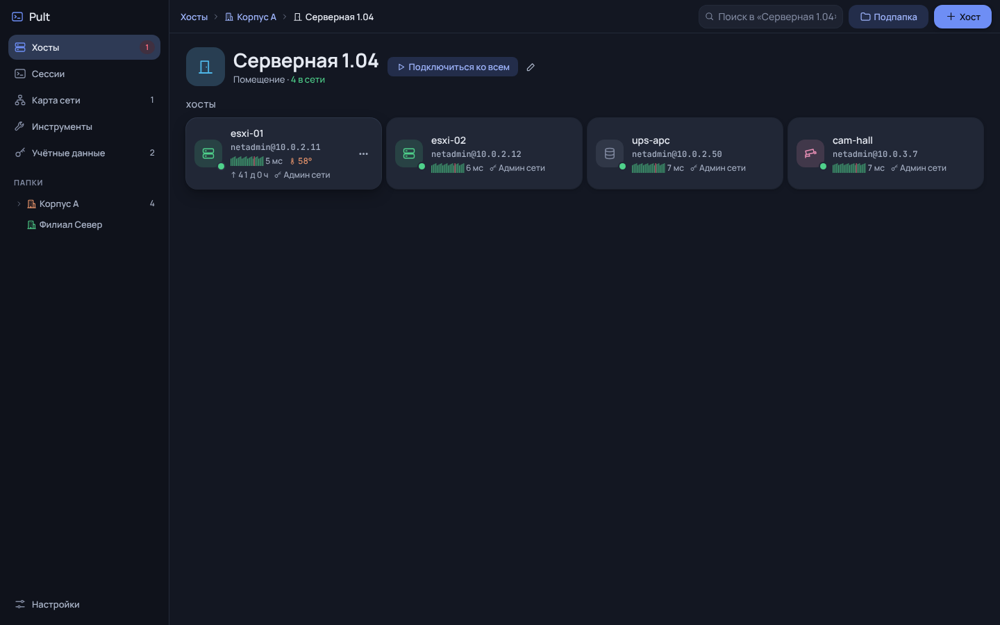
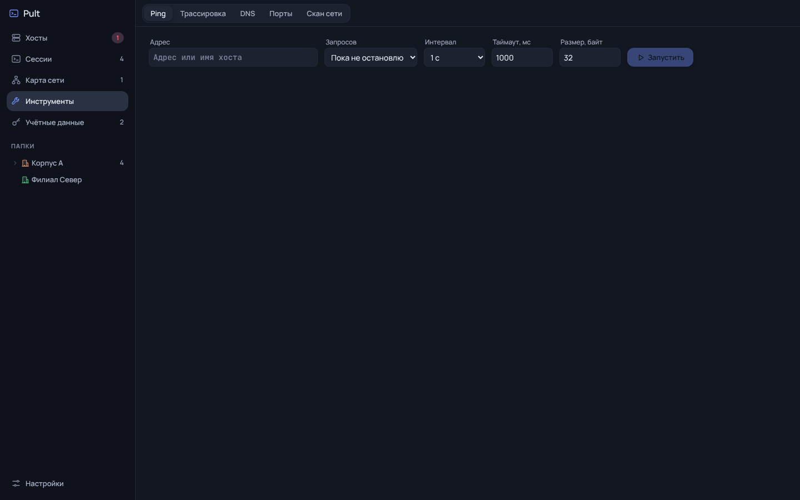
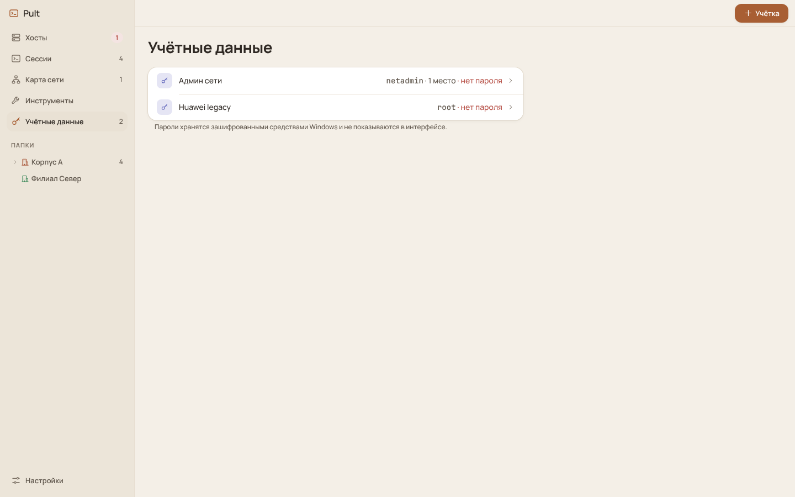
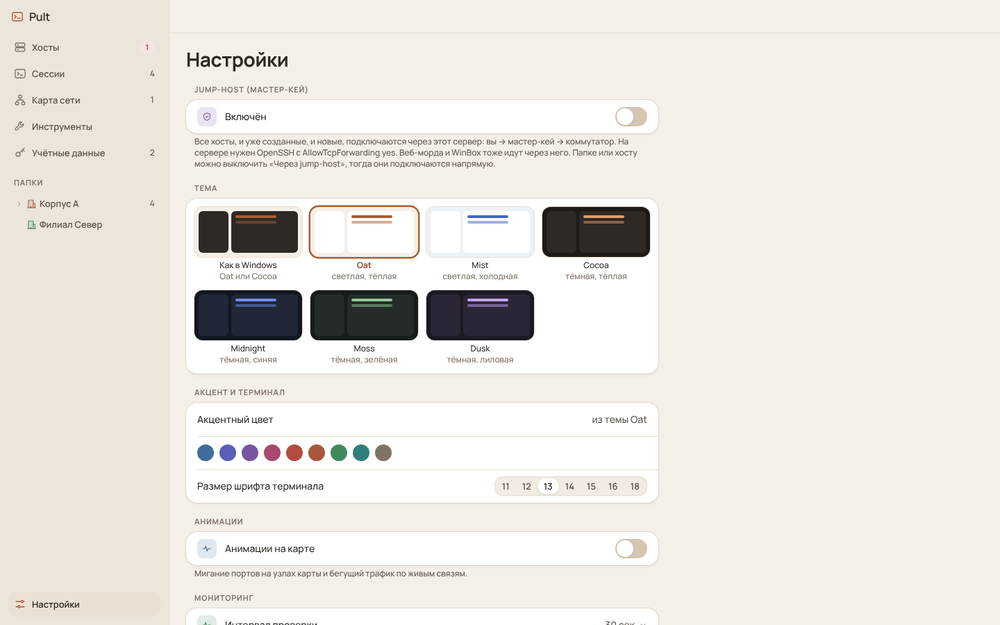

# Pult

Pult — настольный SSH-клиент для администрирования оборудования в локальной сети. Он объединяет список хостов, терминалы, карту сети и сетевые инструменты. Данные хранятся на вашем компьютере; аккаунт и облачная синхронизация не нужны.

## Как выглядит Pult

  
  

  
  

Хосты можно разложить по папкам, открыть несколько SSH-сессий рядом и видеть оборудование на карте. Терминал умеет переподключаться после обрыва; для группы сессий доступен общий ввод.

## Скачать и установить

Откройте [последний релиз](https://github.com/Trapalenok/Pult/releases/latest) и выберите файл под свою систему:

| Система | Установщик | Запуск без установки |
| --- | --- | --- |
| Windows 10/11 x64 | `Pult-Setup-<версия>.exe` | `Pult-<версия>-portable.exe` |
| Windows 7/8.1, Server 2012/2012 R2 x64 | `Pult-Legacy-Setup-<версия>.exe` | `Pult-Legacy-<версия>-portable.exe` |

Pult Legacy собран на Electron 22. Это устаревший движок без обновлений безопасности; используйте его только на старых системах, где обычный Pult не запускается. Обе редакции используют общую базу на одном компьютере, поэтому не запускайте их одновременно.

Файлы пока не подписаны цифровой подписью. Сверьте SHA-256 с `SHA256SUMS.txt` из релиза. После проверки Windows может показать предупреждение SmartScreen о неизвестном издателе.

При установке новой версии поверх старой база остаётся в `%APPDATA%\ssh-client`. Автоматического обновления в приложении нет: для обновления скачайте новый установщик с GitHub Releases.

В следующих версиях планируются сборки для Linux. Поддерживаемые дистрибутивы и форматы пакетов будут указаны в соответствующем релизе после проверки.

## Возможности

- **Подключения.** SSH во вкладках, сетке или отдельных окнах. Папки наследуют логин, порт и другие настройки; для старого оборудования есть совместимые алгоритмы. Можно работать через jump-host или SOCKS5-прокси.
- **Наблюдение за сетью.** Карта, ping, SNMP v2c и LLDP-соседи помогают увидеть доступность устройств. Связи на карте пока расставляются вручную.
- **Работа с хостом.** Из карточки можно открыть веб-интерфейс или WinBox. Сетевые инструменты находятся в отдельном разделе.
- **Перенос данных.** Хосты импортируются из CSV, SQLite и JSON. Конфигурацию с паролями можно перенести на другой компьютер через зашифрованный экспорт.

  
  

  
  

Подробности и снимки экрана — в [инструкции](docs/USAGE.md). История изменений — в [CHANGELOG.md](CHANGELOG.md).

## Данные и ограничения

База каждого пользователя Windows находится в `%APPDATA%\ssh-client\store.json`. Пароли и SNMP community шифруются средствами Windows для текущей учётной записи. Обычное копирование `store.json` на другой ПК не переносит пароли: используйте «Настройки → Перенос конфигурации» и задайте пароль файла. Храните этот файл как секрет.

SNMP v2c передаёт community по сети без шифрования. Проверка ping и SNMP идёт с компьютера пользователя; при использовании jump-host маршрут мониторинга зависит от выбранных настроек. Автоматическое построение связей карты по LLDP пока не реализовано.

Репозиторий пока приватный: страницу релизов и исходники видят пользователи с доступом к нему.

Лицензия: [MIT](LICENSE).
