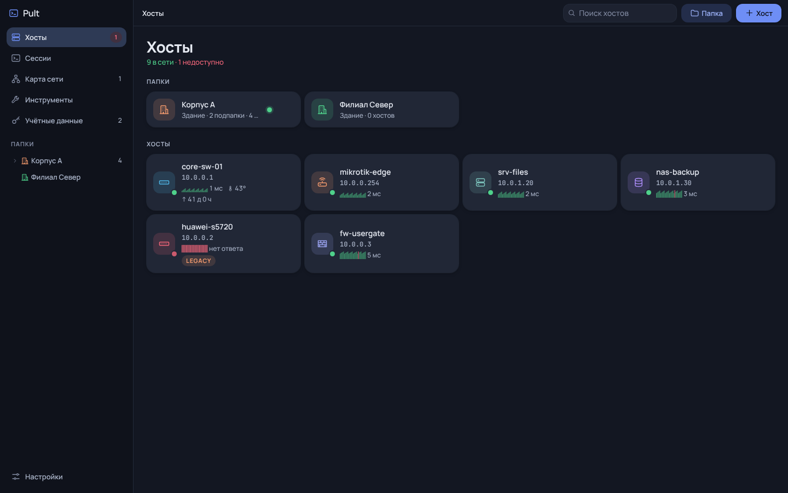
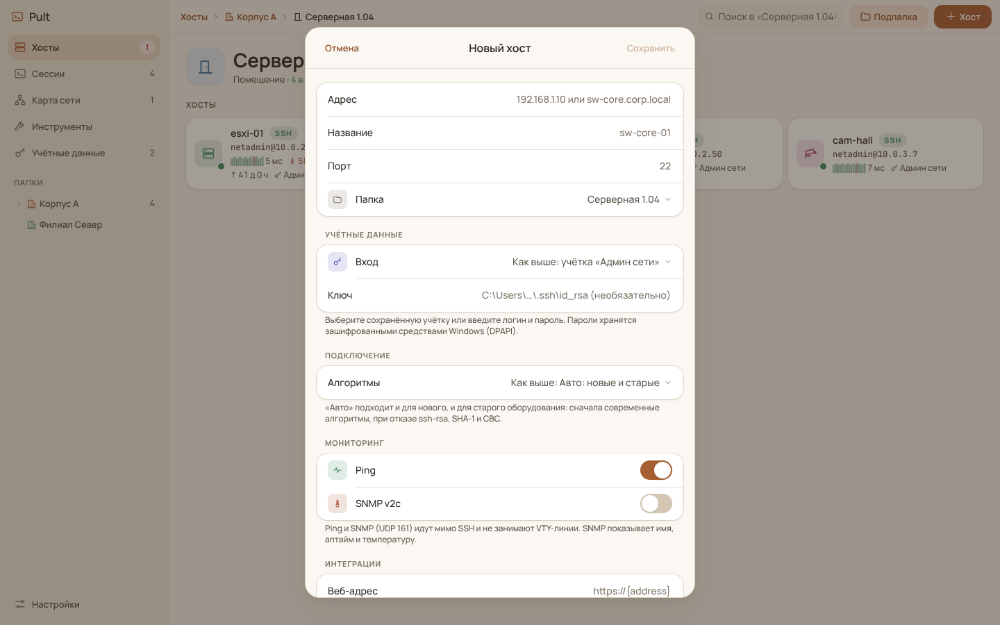
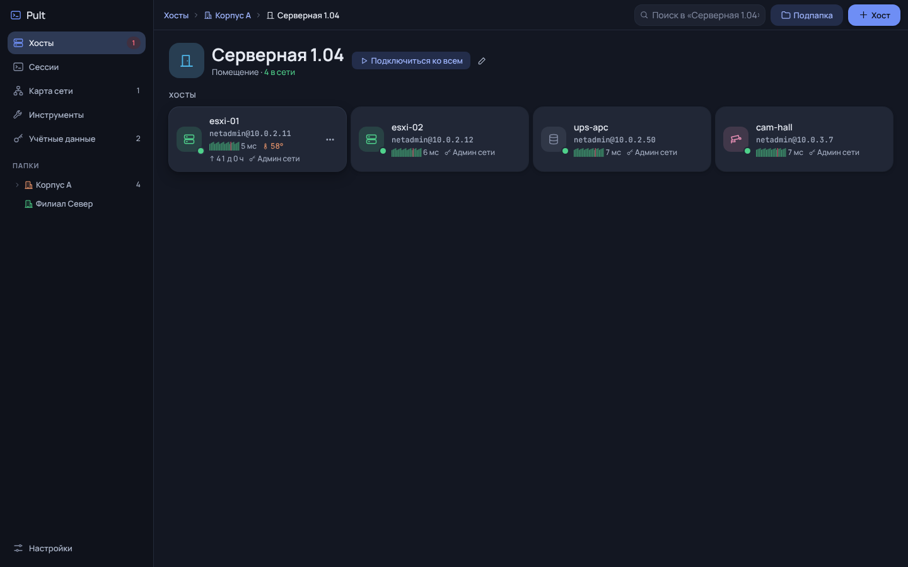
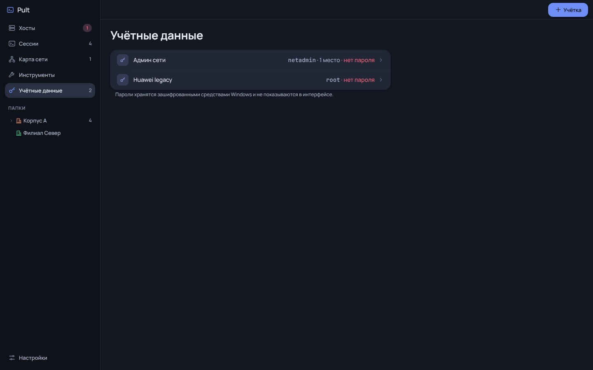
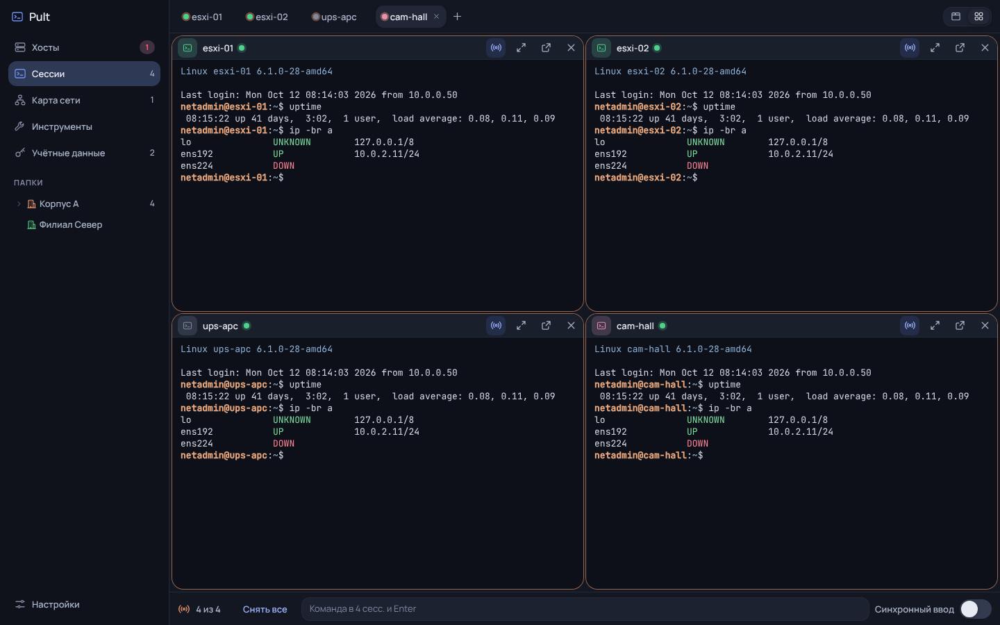
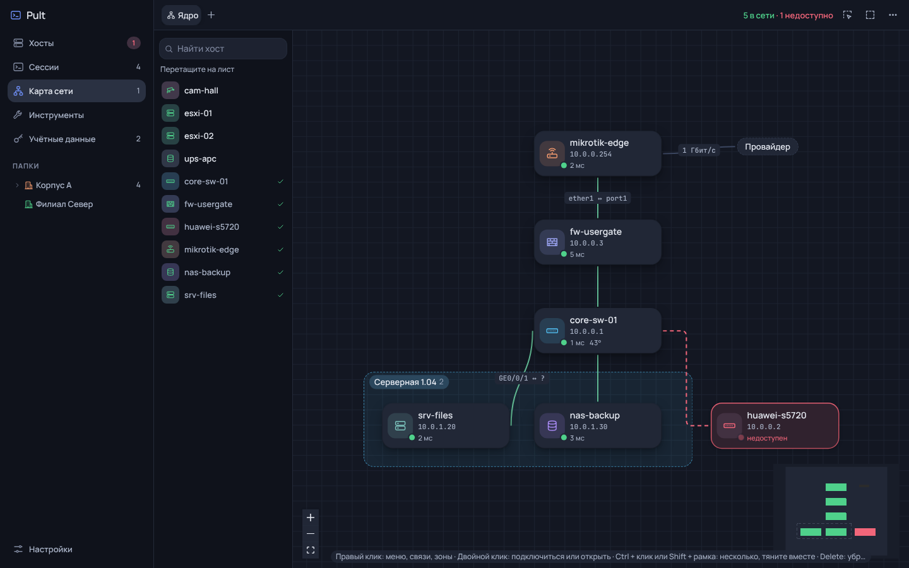
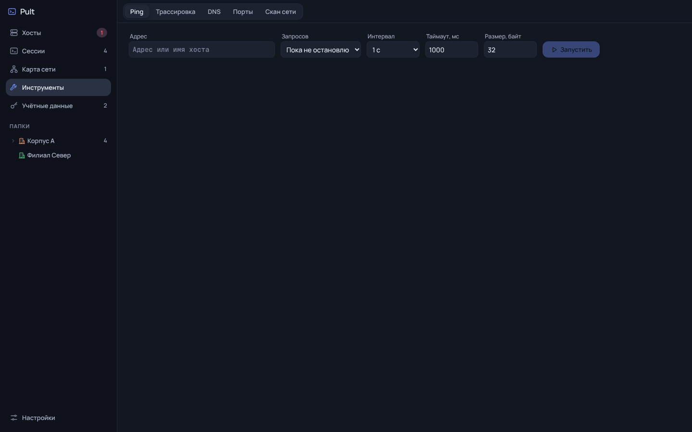
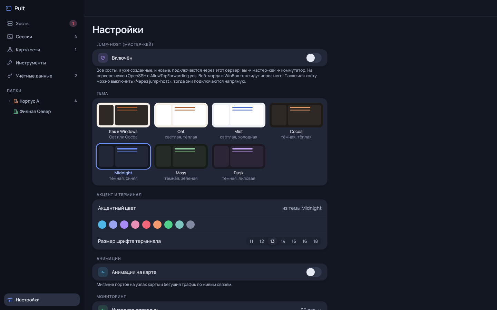

# Pult: как пользоваться

Инструкция к актуальной версии. Скриншоты сняты на демо-базе: все имена и адреса вымышленные.

## 1. Первый запуск

1. Скачайте из [последнего релиза](https://github.com/Trapalenok/Pult/releases/latest) `Pult-Setup-<версия>.exe` (Windows 10/11) или `Pult-Legacy-Setup-<версия>.exe` (Windows 7, 8.1, Server 2012/2012 R2). Если ставить нельзя, берите соответствующий `…-portable.exe`. Репозиторий пока приватный, поэтому для доступа к релизу нужна учётная запись с доступом.
2. SmartScreen скажет, что издатель неизвестен: «Подробнее → Выполнить в любом случае».
3. Пока грузится база, видна заставка с логотипом, потом открывается окно «Хосты». В новой базе лежат примеры папок и хостов, их можно удалить.

База хранится в `%APPDATA%\ssh-client\store.json`, у каждой учётки Windows своя. Пароли зашифрованы средствами Windows и с другого ПК не читаются: для переноса используйте «Настройки → Перенос конфигурации».

## 2. Папки и хосты

- «Папка» создаёт папку, внутри папки «Подпапка» создаёт следующий уровень: здание → этаж → помещение → стойка или кросс.
- «Хост»: адрес (до 3 адресов через «Ещё адрес»), название, порт, папка, учётка, профиль алгоритмов, ping и SNMP.
- Логин, пароль, порт, алгоритмы, jump-host, веб-адрес и WinBox задаются на папку и наследуются всем внутри. Хост может переопределить любое поле.
- Правый клик по хосту или папке открывает меню, двойной клик по хосту подключается.
- Хосты и папки перетаскиваются мышью на другую папку, дерево слева или хлебные крошки.

### Навигация «Назад»

Кнопка «‹» слева от хлебных крошек возвращает в предыдущую открытую папку. То же делают Alt + ← и боковая кнопка мыши.

## 3. Учётные данные

Сохраните логин и пароль один раз и выбирайте учётку в хосте или папке. Если логин не задан или пароль не подошёл, сессия всё равно откроется и спросит `login as:` и `password:` прямо в терминале, а после входа предложит запомнить их для хоста.

При первом подключении к хосту Pult показывает отпечаток его ключа (SHA256) и ждёт подтверждения. Если ключ хоста изменился, будет отдельное предупреждение: подтверждайте, только если знаете причину (замена оборудования, сброс конфигурации).

## 4. Сессии, broadcast и переподключение

- «Подключиться ко всем» на папке, листе карты или Workspace открывает хосты одной вкладкой с сеткой.
- «Broadcast» (Ctrl + Shift + B): всё, что печатаете в любом терминале на экране, уходит во все сессии на экране. Значок в заголовке панели исключает сессию.
- Если связь пропала, сессия остаётся на месте: нажмите «Переподключить» в её заголовке или Enter в терминале. «Переподключить: N» над сеткой поднимает все отключившиеся.
- Любую панель можно развернуть или вынести в отдельное окно.

## 5. Карта сети

- Перетащите хосты из списка слева на лист. Связь рисуется от точки на краю узла к другому узлу, у связи можно указать порты и подпись.
- Зоны (правый клик по пустому месту) рисуют помещения, подложка (кнопка с картинкой) кладёт под лист план этажа.
- Узлы и связи окрашены по ping и SNMP. Двойной клик подключает, Ctrl + клик или Shift + рамка выбирают несколько узлов.

## 6. Мониторинг и инструменты

- Ping и SNMP v2c (UDP 161) включаются на хост или папку и не занимают VTY-линии. Хост считается недоступным, только если не ответили три эха подряд.
- «Инструменты»: непрерывный ping, трассировка, DNS, проверка портов, скан подсети. Всё запускается с этого ПК.

## 7. Настройки

- Jump-host (мастер-кей с OpenSSH) или SOCKS5-прокси для всех хостов.
- Оформление: Shellwise или Ferrum, тема, акцентный цвет, шрифт и цвета терминала.
- Путь к WinBox и «Передавать пароль» (пароль виден в списке процессов, передачу можно выключить).
- Перенос конфигурации: экспорт в JSON (пароли только под паролем файла) и импорт «Добавить новое» или «Заменить всё».
- Импорт из базы другой программы: SQLite, CSV (UTF-8 или Windows-1251), JSON.

## 8. Обновление

Скачайте новый Setup и запустите поверх установленного Pult: база, пароли и ключи хостов остаются. Портативная версия просто заменяется новым файлом.
